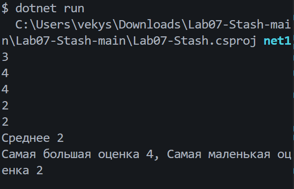
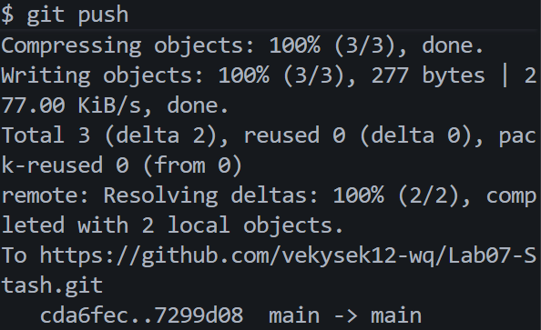

# Практическая работа №7

**ФИО:** [Ваше ФИО]
**Группа:** [Ваша группа]
**Дата:** [Дата выполнения]

## Что изучено

- Индексация массива начинается с нуля: первый элемент — `a[0]`, последний — `a[a.Length - 1]`; обращение к индексу за пределами массива вызывает `IndexOutOfRangeException`.
- Цикл `for` нужен, когда важен индекс: для изменения элементов (`a[i] = ...`), вывода позиций или обхода в обратном порядке; `foreach` удобен, когда нужны только значения и массив не изменяется.
- Свойство `Length` даёт количество элементов, а суммирование/поиск минимума и максимума делаются через накопление в переменной-аккумуляторе при переборе массива.

## Скриншоты

